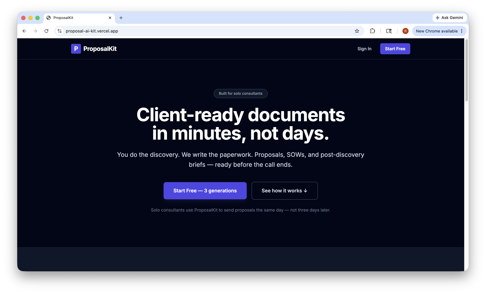
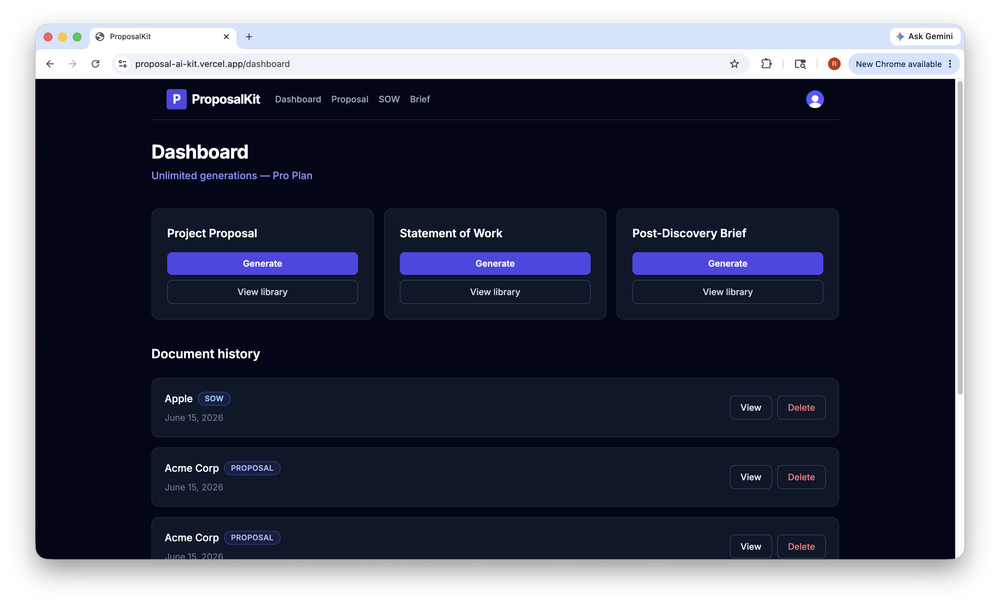
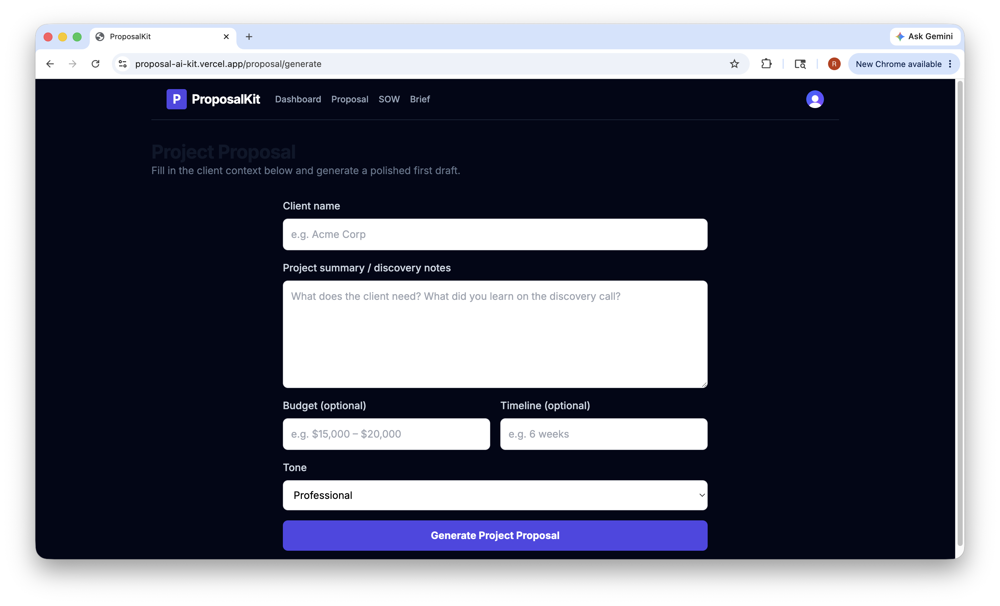

# ProposalKit

**[Live demo →](https://proposal-ai-kit.vercel.app)**

Every new client deal means hours rebuilding the same documents from scratch — digging through old proposals, reformatting SOWs, and turning raw discovery notes into something client-ready. **ProposalKit** replaces that manual workflow with a production SaaS app: sign in, add client context and discovery notes, and generate structured **Project Proposals**, **Statements of Work**, and **Post-Discovery Briefs** in minutes — saved to your library and ready to export. Built and shipped end-to-end to solve a real consultant bottleneck, not a toy demo.

<p align="center">
  
</p>

<p align="center">
  
  &nbsp;
  
</p>

Modeled after [RecruitKit](https://github.com/RichTravels/recruitkit)'s architecture: Next.js, Clerk, Supabase, Prisma, and Claude.

---

## Architecture

```
User signs in (Clerk)
        ↓
  [ensureUser] → upserts user into Postgres
        ↓
  [GenerateDocumentForm] → client context + discovery notes
        ↓
  [generateDocument action] → validates input, calls Claude
        ↓
  [DB Write] → saves to Document table (linked to User)
        ↓
  [Frontend] → renders result + library
```

---

## Tech Stack

| Layer | Technology |
|---|---|
| Frontend | Next.js 14 (App Router), TypeScript, Tailwind CSS |
| Authentication | Clerk |
| AI Generation | Anthropic Claude |
| Database | Supabase (PostgreSQL) |
| ORM | Prisma |
| Deployment | Vercel |

---

## Running Locally

```bash
cd ProposalKit
npm install
cp .env.example .env.local
# Fill in Clerk, Supabase, Anthropic, and Stripe keys
npm run db:push
npm run dev
```

Open [http://localhost:3000](http://localhost:3000)

---

## Project Structure

```
proposalkit/
├── src/
│   ├── app/
│   │   ├── (app)/
│   │   │   ├── dashboard/
│   │   │   ├── proposal/generate|library/
│   │   │   ├── sow/generate|library/
│   │   │   └── brief/generate|library/
│   │   ├── actions/
│   │   │   ├── generateDocument.ts
│   │   │   └── deleteDocument.ts
│   │   ├── sign-in/
│   │   └── sign-up/
│   ├── components/
│   │   ├── GenerateDocumentForm.tsx
│   │   ├── DocumentLibrary.tsx
│   │   └── Header.tsx
│   └── lib/
│       ├── anthropic.ts
│       ├── db.ts
│       └── env.ts
├── prisma/
│   ├── schema.prisma
│   └── migrations/
└── .env.example
```

---

## Database Schema

- **User** — synced from Clerk; tracks free-tier `generationQuota` (3 by default), Pro status, and Stripe IDs (`stripeCustomerId`, `stripeSubscriptionId`)
- **Document** — saved outputs with type (`PROPOSAL`, `SOW`, `BRIEF`), client title, content, and tone
- **StripeWebhookEvent** — idempotency log for processed Stripe webhook events

---

## Billing (Stripe)

ProposalKit Pro ($29/mo) uses **Stripe Checkout** for subscriptions and the **Stripe Customer Portal** for self-service cancel/update payment.

**Webhook endpoint:** `https://proposal-ai-kit.vercel.app/api/stripe/webhook`

**Events handled:** `checkout.session.completed`, `customer.subscription.updated`, `customer.subscription.deleted`, `invoice.payment_failed`
